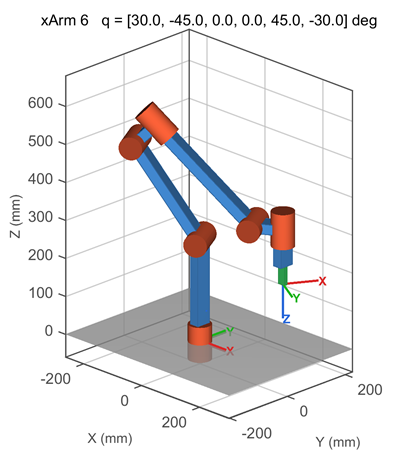
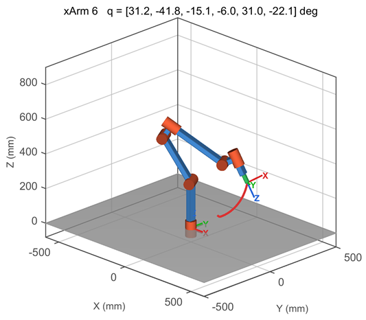
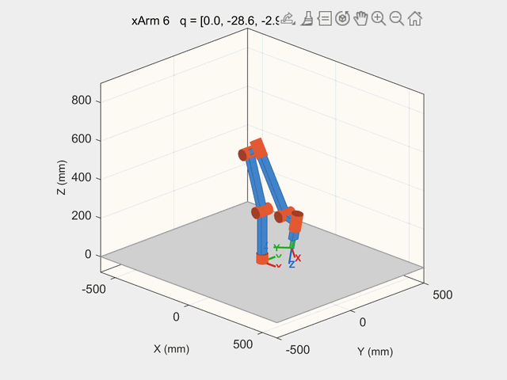

# XArm6 Kinematic Simulator
Matlab and Python Files to Simulate the Kinematics of a UFactory xArm6 Robot Arm. Functions are provided for solving the forward kinematics, inverse kinematics, and 3-D visualisation of the [UFactory xArm 6](https://www.ufactory.cc/xarm-collaborative-robot) robotic arm.

# Features
- **Forward kinematics** returns the flange and TCP pose in four orientation conventions simultaneously: homogeneous matrix, roll-pitch-yaw (XYZ fixed-angle), unit quaternion, and axis-angle vector (UFactory convention).
- **Inverse kinematics** returns joint angles from a know pose using a numerical Jacobian damped-least-squares solver with multiple random seeds. Accepts target poses in any of the same four conventions. The solver accounts for the non-spherical wrist geometry (joint-5 offset of 76 mm).
- **3-D visualiser** — rectangular beam links, capped cylinders aligned to each joint's rotation axis, coordinate frame triads at the base and TCP by default, and an animated TCP trajectory example.
- **Configurable** with a single definition of DH parameters, joint limits, TCP offset+bounding box defined in "xarm6_params". Changes are automatically propagated to FK, IK, and the visualiser.
---

## File overview

| File | Purpose |
|---|---|
| `xarm6_params.py` / `.m` | DH table, joint limits, TCP offset, tool bounding box |
| `xarm6_fk.py` / `.m` | Forward kinematics → flange + TCP pose in all conventions |
| `xarm6_ik.py` / `.m` | Inverse kinematics — accepts T, RPY, quaternion, or axis-angle |
| `xarm6_plot.py` / `.m` | 3-D visualiser with optional TCP trajectory |
| `xarm6_kinematics_demo.py` / `.m` | FK/IK validation + Monte-Carlo accuracy test |
| `xarm6_plot_demo.py` / `.m` | Static pose viewer, IK verification, and animation |
| `xarm6_reload.py` | Reload all modules after editing `xarm6_params` (Python only) |

## Python Requirements
numpy >= 1.24 
matplotlib >= 3.7

## MATLAB Requirements
nothing. Tested on Matlab R2023a.

## Orientation conventions

All conventions follow the UFactory SDK definitions:
| Field | Convention |
|---|---|
| `rpy` | XYZ fixed-angle: R = Rz(yaw) · Ry(pitch) · Rx(roll) |
| `quat` | Unit quaternion [w, qx, qy, qz], w ≥ 0 |
| `axis_angle` | Compact rotation vector [Rx, Ry, Rz] = φ · [nx, ny, nz], φ ≥ 0 |

## Joint limits
Actual UFactory xArm 6 joint limits are considered namely:
| Joint | Lower | Upper |
|---|---|---|
| q1 | −360° | +360° |
| q2 | −118° | +118° |
| q3 | −225° | +11°  |
| q4 | −360° | +360° |
| q5 | −97°  | +180° |
| q6 | −360° | +360° |

Prof. Lionel Birglen 
Polytechnique Montreal, 2026 
License: GNU GPL v3

###  DISCLAIMER:
This hardware project is provided "as is", and at your own risk. Under no circumstances shall any author be liable for direct, indirect, special, incidental, or consequential damages resulting from the use, misuse, or inability to use this hardware/software, even if the authors have been advised of the possibility of such damages.
